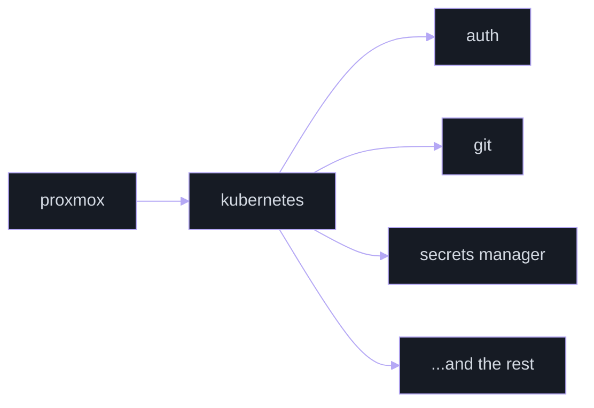

<div align="center">

<pre>
              _
 _   ______ _(_)___  ____  ____  _____
| | / / __ `/ / __ \/ __ \/ __ \/ ___/
| |/ / /_/ / / / / / / / / /_/ / /
|___/\__,_/_/_/ /_/_/ /_/\____/_/
</pre>

**homelab, air traffic control tooling, and whatever else is running this week.**

<a href="https://vainnor.com"></a>

    

[ [vainnor.com](https://vainnor.com) ] &nbsp; [ [status](https://status.vainnor.com) ] &nbsp; [ [git](https://git.vainnor.com) ] &nbsp; [ [vzdc.org](https://vzdc.org) ]

</div>

```text
vainnor@lab:~$ whoami
vainnor
vainnor@lab:~$ cat about.txt
runs a kubernetes homelab on proxmox
writes rust and react
does atc work on vatsim: training tools, artcc websites
vainnor@lab:~$ █
```

## #projects

| project | what it is |
| :-- | :-- |
| [vzdc_website](https://github.com/vZDC-ARTCC/website) | a website for a vatsim subdivision |
| [vzdc_ids](https://github.com/vZDC-ARTCC/ids) | the vZDC ARTCC's modern take on an IDS |
| [zdc-cli](https://github.com/Vainnor/zdc-cli) | a command-line tool for the vZDC ARTCC |
| [muster](https://github.com/Vainnor/muster) | a small, fast desktop app launcher for windows, macos and linux, with one-click launchable app groups (early scaffold) |
| [tessera](https://github.com/Vainnor/tessera) | a local-first notes app on plain markdown files, with end-to-end encrypted sync (early scaffold) |
| [aviodeck](https://aviodeck.app) | free flight sim tools for streamers, pilots and controllers: stream overlays, twitch automation, a discord bot and vatsim tools |

## #vainnorlabs



| service | what it does |
| :-- | :-- |
| [status.vainnor.com](https://status.vainnor.com) | is everything up? checked once a minute |
| [git.vainnor.com](https://git.vainnor.com) | the forge |

## #elsewhere

| | |
| :-- | :-- |
| [github](https://github.com/Vainnor) | code, mostly |
| [vzdc](https://vzdc.org) | the Virtual Washington ARTCC, on the VATSIM network |
| [vainnor.com](https://vainnor.com) | the homepage |

<div align="center">
<sub>vainnorlabs // <a href="https://status.vainnor.com">status</a></sub>
</div>
