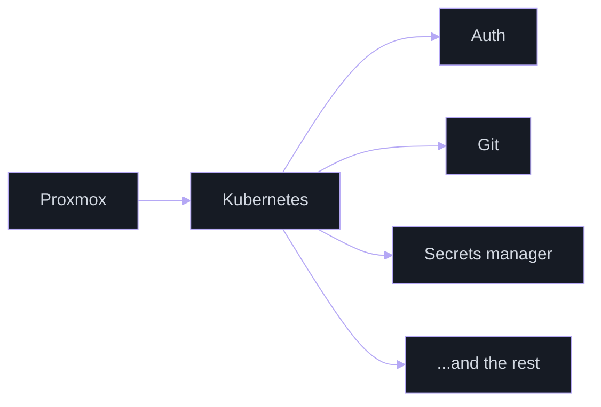

<div align="center">

<pre>
              _
 _   ______ _(_)___  ____  ____  _____
| | / / __ `/ / __ \/ __ \/ __ \/ ___/
| |/ / /_/ / / / / / / / / /_/ / /
|___/\__,_/_/_/ /_/_/ /_/\____/_/
</pre>

**Homelab, air traffic control tooling, and whatever else is running this week.**

<a href="https://vainnor.com"></a>

    

[ [vainnor.com](https://vainnor.com) ] &nbsp; [ [Status](https://status.vainnor.com) ] &nbsp; [ [Git](https://git.vainnor.com) ] &nbsp; [ [mainlinesim.com](https://mainlinesim.com) ] &nbsp; [ [vzdc.org](https://vzdc.org) ]

</div>

```text
vainnor@lab:~$ whoami
vainnor
vainnor@lab:~$ cat about.txt
Founder of Mainline Sim.
Runs a Kubernetes homelab on Proxmox.
Writes Rust and React.
Does ATC work on VATSIM: training tools and ARTCC websites.
vainnor@lab:~$ █
```

## Projects

| Project | What it is |
| :-- | :-- |
| [Mainline Sim](https://mainlinesim.com) | Founder. A US freight and passenger train simulator, in development. |
| [Stepclimb](https://github.com/Vainnor/stepclimb) | An open-source learning platform with courses, server-graded exams, practice games, and integrations. Built with Rust and React. |
| [vZDC Website](https://github.com/vZDC-ARTCC/website) | A website for a VATSIM subdivision. |
| [vZDC IDS](https://github.com/vZDC-ARTCC/ids) | The vZDC ARTCC's modern take on an IDS. |
| [zdc-cli](https://github.com/Vainnor/zdc-cli) | A command-line tool for the vZDC ARTCC. |
| [Muster](https://github.com/Vainnor/muster) | A small, fast desktop app launcher for Windows, macOS, and Linux, with app groups you can launch in one click. |
| [Tessera](https://github.com/Vainnor/tessera) | A local-first notes app built on plain Markdown files, with end-to-end encrypted sync. |
| [AvioDeck](https://aviodeck.app) | Free flight sim tools for streamers, pilots, and controllers: stream overlays, Twitch automation, a Discord bot, and VATSIM tools. |

## VainnorLabs



| Service | What it does |
| :-- | :-- |
| [status.vainnor.com](https://status.vainnor.com) | Is everything up? Checked once a minute. |
| [git.vainnor.com](https://git.vainnor.com) | The forge. |

## Elsewhere

| | |
| :-- | :-- |
| [GitHub](https://github.com/Vainnor) | Code, mostly. |
| [Mainline Sim](https://mainlinesim.com) | The train sim I founded. |
| [vZDC](https://vzdc.org) | The Virtual Washington ARTCC on the VATSIM network. |
| [vainnor.com](https://vainnor.com) | My homepage. |

<div align="center">
<sub>VainnorLabs // <a href="https://status.vainnor.com">Status</a></sub>
</div>
